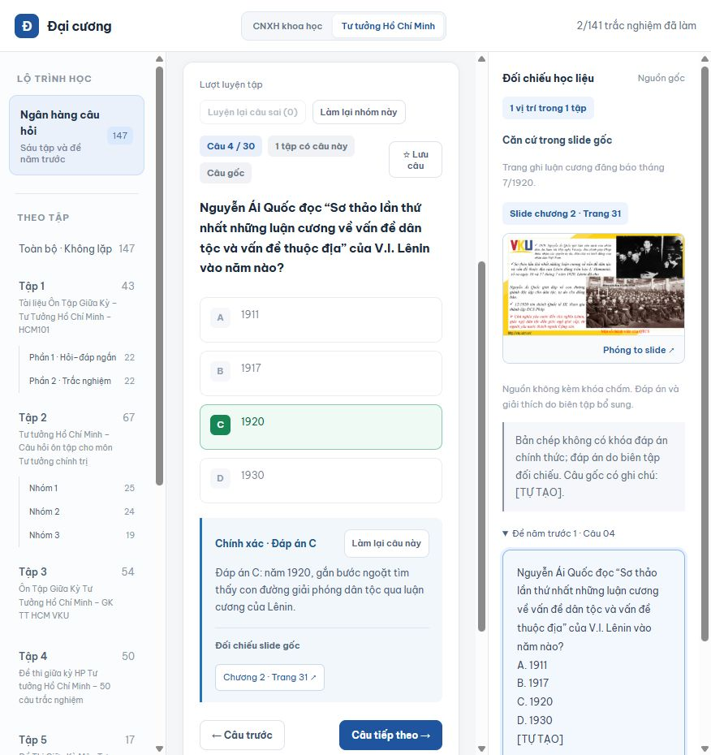
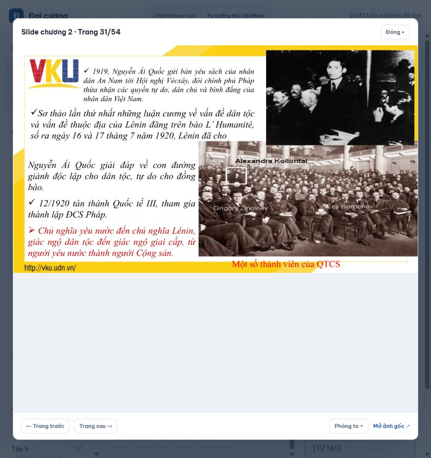

# Đại cương VKU — Study Hub

Website ôn tập các môn đại cương dành cho sinh viên **Trường Đại học Công nghệ Thông tin và Truyền thông Việt – Hàn (VKU), Đại học Đà Nẵng**. Học bằng câu hỏi trắc nghiệm, xem giải thích và đối chiếu ngay với tài liệu gốc.

**[Vào website](https://dai-cuong-study-hub.vercel.app/)** · **[Ngân hàng Tư tưởng Hồ Chí Minh](https://dai-cuong-study-hub.vercel.app/?course=hcm&track=bank)** · **[Đóng góp dữ liệu](CONTRIBUTING.md)**

## Giao diện

Chọn chương/tập ở bên trái, làm câu hỏi ở giữa và xem đúng trang slide bên phải sau khi trả lời.



<details>
<summary>Xem ảnh tính năng phóng to slide gốc</summary>

Mở từ ảnh bên phải hoặc nút chương/trang dưới giải thích. Có thể phóng to, chuyển trang và mở ảnh gốc.



</details>

## Website có gì?

| Phần ôn tập | Nội dung hiện có | Cách học |
| --- | --- | --- |
| **Chủ nghĩa xã hội khoa học** | 249 câu: 123 từ ghi chú, 126 từ slide; 8 đề giữa kỳ; 125 trang slide gốc | Học ghi chú trước, sau đó ôn ý chính từ slide chương 1–4 |
| **Tư tưởng Hồ Chí Minh · Ôn theo slide** | 240 câu: chương 1 có 30, chương 2 có 90, chương 3 có 120; 8 đề; 131 trang học liệu | Chọn từng chương, luyện câu hỏi và đối chiếu văn bản, ảnh PDF gốc |
| **Tư tưởng Hồ Chí Minh · Ngân hàng riêng** | Sáu tập và **Đề năm trước 1** giữ đủ 30 vị trí câu; mục Toàn bộ có 147 nội dung sau gộp trùng | Ôn theo tập/nhóm hoặc toàn bộ; xem bản câu gốc và các vị trí xuất hiện |

Mỗi đề giữa kỳ có **30 câu trong 15 phút**, tự nộp khi hết giờ. HCM có bốn đề chương 1–2 và bốn đề riêng chương 3.

### Các tính năng chính

- Hiện đáp án, giải thích và nguồn sau khi chọn trong chế độ luyện tập.
- Đọc học liệu, xem ảnh slide gốc, phóng to và chuyển trang.
- Tìm theo từ khóa, lọc theo chương/tập/nhóm và lưu câu cần ôn.
- Làm lại từng câu, nhóm đang chọn hoặc các câu sai; khi làm lại, đáp án và nguồn được ẩn lại.
- Giữ tiến độ **đã làm** riêng với câu trả lời của lượt luyện; sửa đúng câu sai cập nhật kết quả gần nhất.
- Làm đề có đồng hồ, xem đáp án sau khi nộp, lưu điểm gần nhất và điểm cao nhất.
- Chuyển môn trên thanh đầu trang. CNXHKH, HCM theo slide và ngân hàng HCM lưu tiến trình riêng.

## Sử dụng như thế nào?

1. **[Mở website](https://dai-cuong-study-hub.vercel.app/)** và chọn môn ở đầu trang. Không cần đăng ký tài khoản.
2. **Chọn nguồn học.** CNXHKH bắt đầu từ Ghi chú; HCM chọn Ôn theo slide hoặc Ngân hàng câu hỏi.
3. **Chọn phạm vi.** Chọn chương, tập/nhóm hoặc Đề năm trước 1 ở cột trái; dùng ô tìm kiếm nếu cần.
4. **Chọn đáp án.** Đọc giải thích bên dưới, xem ảnh và số trang trong cột Đối chiếu học liệu. Bấm ảnh hoặc nút chương/trang để phóng to.
5. **Ôn lại.** Dùng Lưu câu, Làm sai, Luyện lại câu sai, Làm lại câu này hoặc Làm lại nhóm này. Tiến độ đã làm vẫn được giữ khi bắt đầu lượt mới.
6. **Tự kiểm tra.** Trong phần ôn theo bài học, chọn Đề 30 câu · 15 phút, làm bài và nộp để xem điểm cùng nguồn đối chiếu.

| Phím tắt | Thao tác |
| --- | --- |
| `1`, `2`, `3`, `4` | Chọn A, B, C, D khi làm câu hỏi hoặc đề |
| `←`, `→` | Chuyển câu; khi mở khung slide thì chuyển trang slide |

Tiến trình lưu bằng **localStorage trên trình duyệt đang dùng**, chưa có đồng bộ tài khoản giữa các thiết bị. Xóa dữ liệu website hoặc dùng trình duyệt khác sẽ không mang theo tiến trình cũ.

### Hiểu các nhãn đối chiếu

Ảnh HCM được xuất trực tiếp từ bốn PDF gốc, tổng **175 trang**. Phần ôn theo slide dừng ở chương 3; ảnh chương 4 dùng để đối chiếu các câu đã có trong ngân hàng.

- **Căn cứ trong slide gốc:** có nội dung hỗ trợ trả lời; ghi rõ chương và trang PDF, đếm từ 1.
- **Slide liên quan:** cùng chủ đề nhưng thiếu chi tiết cần chấm; cần xem nguồn bổ sung.
- **Không có căn cứ trực tiếp trong bốn PDF:** chi tiết không có trong bộ slide đã nhận.
- **Cần đối chiếu / Tự luận:** không tự chấm A–D khi chưa xác định được một đáp án duy nhất hoặc câu yêu cầu phân tích.

Ngân hàng HCM có 141 mục trắc nghiệm chấm điểm, 4 mục cần đối chiếu và 2 mục tự luận ở chế độ Toàn bộ. Đề năm trước 1 giữ đủ 30 vị trí; câu 1 chưa chấm do phương án chồng lấn. Các câu phục dựng và hiệu đính có ghi chú để kiểm tra.

## Đóng góp dữ liệu

Bạn có thể gửi slide, văn bản đã trích xuất, câu hỏi, đề năm trước, lời giải hoặc báo câu sai/trỏ nhầm trang.

- **Không cần biết code:** [gửi dữ liệu qua Issue](https://github.com/Vcoch27/dai-cuong-vku-study-hub/issues/new?template=data-contribution.yml) hoặc [báo lỗi câu hỏi](https://github.com/Vcoch27/dai-cuong-vku-study-hub/issues/new?template=question-correction.yml).
- **Có thể dùng Git:** fork repo, tạo nhánh và gửi Pull Request. Có thể gửi dữ liệu thô trước, không bắt buộc tự tích hợp vào ứng dụng.
- **Bắt đầu tại đây:** [Hướng dẫn đóng góp](CONTRIBUTING.md) và [mẫu dữ liệu câu hỏi](contributions/question-template.md).

Tài liệu qua Issue/PR được rà nguồn, đáp án, câu trùng và trang đối chiếu trước khi đưa lên website. Hiện chưa có màn hình tự nhập dữ liệu trên web.

## Chạy tại máy

Chỉ cần Python để chạy bản web có sẵn trong `dist/`:

```sh
git clone https://github.com/Vcoch27/dai-cuong-vku-study-hub.git
cd dai-cuong-vku-study-hub
python -m http.server 4173 -d dist
```

Mở **http://localhost:4173**. Đây là ứng dụng HTML/CSS/JavaScript tĩnh; không cần cài Node để sử dụng bản đã dựng.

## Cấu trúc repo

| Đường dẫn | Vai trò |
| --- | --- |
| `dist/` | Website và dữ liệu đầu ra, triển khai lên Vercel |
| `content/hcm/` | Văn bản bài học, câu HCM theo slide, đề và manifest trang PDF |
| `content/hcm-bank/` | Nguồn ngân hàng, quyết định biên tập và bảng đối chiếu từng câu |
| `sources/hcm/` | Bốn PDF HCM gốc |
| `slidegk/` | PowerPoint CNXHKH gốc |
| `reviewed_questions.py` | Nội dung CNXHKH đã biên tập |
| `contributions/` | Mẫu chuẩn bị dữ liệu đóng góp |
| `tests/` | Kiểm tra luồng học, tiến trình, đề và ảnh đối chiếu |

Các lệnh dựng và kiểm tra theo phần thay đổi nằm trong [CONTRIBUTING.md](CONTRIBUTING.md). Công cụ biên tập: Python, Node.js; Pillow/PyMuPDF khi dựng ảnh PDF. Xuất lại PowerPoint cần Windows có Microsoft PowerPoint.

Tài liệu chi tiết: [HCM theo slide](content/hcm/README.md) · [Ngân hàng HCM](content/hcm-bank/README.md) · [Bảng đối chiếu slide](content/hcm-bank/slide-review-report.md) · [Quy tắc biên soạn](writing-block.md).

## Phạm vi nội dung

Nội dung được biên soạn theo tài liệu lớp học và nguồn được cung cấp, không phải khóa đáp án chính thức của mọi lớp/giảng viên. Phần chữ mờ, câu phục dựng, đáp án còn tranh luận hoặc thông tin ngoài slide có ghi chú riêng. Khi báo lỗi, hãy kèm câu hỏi, lựa chọn và trang nguồn để cùng kiểm tra.
